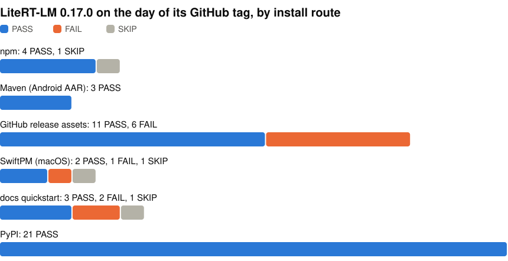

# litertlm-release-gate

Scripts that install each [LiteRT-LM](https://github.com/google-ai-edge/LiteRT-LM) release the way a user would and try to generate text with it. LiteRT-LM is Google's framework for running LLMs on edge devices. The scripts cover npm, Maven for Android, the GitHub release assets, SwiftPM for macOS and the README's quickstart, so if you build on LiteRT-LM you can see whether a release worked through the route you install from.

<p align="center">
<picture>
  <source media="(prefers-color-scheme: dark)" srcset="https://raw.githubusercontent.com/john-rocky/litertlm-release-gate/main/docs/images/checks-dark.svg">
  
</picture>
</p>

I ship [conversions on top of LiteRT-LM](https://huggingface.co/litert-community). litert-lm 0.15.0 silently invalidated bundles I had already shipped, and I found out from a user rather than from a check. I wrote these checks after that.

The newest results are for 0.17.0, from 2026-09-09, in [results/v0.17.0-generation.md](results/v0.17.0-generation.md). Later releases have not been run yet. Each FAIL links the issue filed for it, and a SKIP means the check could not run. The 21 PyPI checks load published models through `pip install litert-lm==0.17.0`, in a separate run from 2026-09-06. Earlier runs are in [docs/history.md](docs/history.md).

**Did an install fail for you?** [Open a report](https://github.com/john-rocky/litertlm-release-gate/issues/new?template=channel-report.yml) with the command and the output. I re-run that check, and if it fails again I file it upstream and link the issue from the results.

## Run it

```bash
./run_channels.sh                 # all channels + summary table
./run_channels.sh --no-device     # skip the check on an Android phone
./run_channels.sh --only npm,swiftpm
```

Each script also runs on its own, such as `./npm_check.sh` or `python3 gh_assets_check.py`. Results land in `results_<date>/` as one JSON per channel, and `make_table.py` merges them into a PASS/FAIL table under `results/`. For a new release, set the `GEN_*` versions in `pins.env`, run `./run_channels.sh`, and compare the table with the last one.

You need a Mac with `python3`, `npm`, Google Chrome, `uv` and Xcode. The Android check also needs JDK 17, the Android SDK and one `adb` device, and it is skipped when there is none.

## What each script checks

- `npm_check.sh`: what the npm packages contain, and one real inference in headless Chrome.
- `maven_check.sh`: the Android library resolves, an app builds against it, and a phone generates text with it.
- `gh_assets_check.py`: the release files match their declared checksums and hold what they should.
- `swiftpm_check.sh`: the Swift package builds at the release tag and generates on a small model.
- `quickstart_check.sh`: the README's own commands, run as written, which also install from PyPI.

More detail is in [docs/channels.md](docs/channels.md).

## More

- [Workarounds the scripts use](docs/notes.md)
- [wrappers/TABLE.md](wrappers/TABLE.md): the LiteRT-LM version each wrapper and app uses

## License

Apache-2.0. Issue numbers in the scripts and results point at [google-ai-edge/LiteRT-LM](https://github.com/google-ai-edge/LiteRT-LM/issues) and [google-ai-edge/LiteRT](https://github.com/google-ai-edge/LiteRT/issues).
